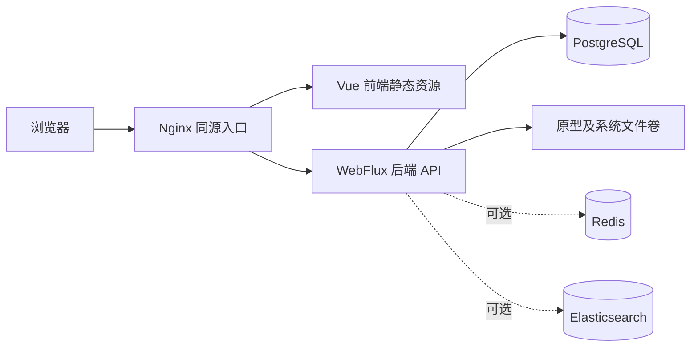

# PrototypeHub

**轻量、可自托管的原型管理与交付平台。**

PrototypeHub 面向产品经理、UI/UX 设计师、研发与测试团队，将分散的原型文件集中管理，让需求评审、版本交付和跨团队沟通有一个稳定入口。上传 Axure 等工具导出的静态 HTML ZIP，即可在线浏览页面、体验交互、检查元素，并通过带密码、有效期及启停控制的链接分享原型。

**设计工具导出 HTML → ZIP 上传 → 文件校验与解压 → 在线预览 → 可控分享 → 研发与测试交付**

产品名称为 **PrototypeHub**；本仓库是其后端工程，沿用 Maven 工程名与镜像名 `proto-bridge`、Java 包根 `com.gaiys.proto`。配套 Vue 前端独立维护，发布入口与许可均以其仓库为准，同样以其独立仓库中的 Apache-2.0 声明为准。后端可运行于 JAR 或 Docker，前端可由 Nginx 静态托管或容器运行；运行依赖来自公开仓库。

## 核心特性

- **集中管理与版本交付**：按项目管理原型版本，上传或替换 HTML ZIP，自动登记页面和资源，减少反复传压缩包与手工部署。
- **项目成员与访问范围**：所有者、编辑者及只读成员按项目协作；内部预览使用可撤销的短期凭证，公开分享独立授权。
- **浏览器预览与检查**：浏览页面树、交互页面和静态资源，提供元素检查入口，便于研发与测试理解页面细节。
- **可控分享**：独立分享链接、访问密码、有效期及启用/停用，适用于需求评审与外部交付。
- **平台管理**：用户、角色、组织、职位、菜单与按钮权限、数据字典、品牌配置、个人中心和日志管理。
- **文件安全与一致性**：校验上传限额、ZIP 路径与条目，管理解压、替换、清理任务和失败重试。
- **自主部署**：PostgreSQL 与本地文件存储即可运行；Redis、Elasticsearch 按需要启用，支持同源 HTTPS 部署。

同一部署默认最多保有 5 个项目、每个项目最多 5 个逻辑版本；原位替换不增加用量，历史超限数据保留，新增由服务端限制，详见[容量与创建请求说明](doc/public/API.md#原型容量与创建重试)。

适合个人原型归档、小团队需求评审和企业内部交付平台。当前以静态 HTML 包为载体，**不提供 Figma 原生文件导入、在线原型编辑或多人实时协同编辑**。平台账号、按钮权限及项目成员范围共同约束原型访问。旧项目须经[归属预检、迁移或认领](doc/public/DATA.md#项目归属迁移与认领)后供成员访问；内部预览旧长期链接停止授权，前后端需配套升级。公开分享是独立外部授权，撤员不会自动撤销已经公开的分享链接。

## 导航

[快速开始](#快速开始) · [技术架构](#技术架构) · [配置说明](#配置说明) · [可选中间件](#可选中间件) · [本地开发](#本地开发) · [打包和镜像](#打包和镜像) · [服务器部署](#服务器部署) · [常见问题](#常见问题) · [路线图](#路线图) · [参与贡献](#参与贡献) · [文档索引](#文档索引) · [许可证与致谢](#许可证与致谢)

## 快速开始

以下步骤使用 **PostgreSQL + 本地文件存储**，先运行后端，再连接配套前端；不需要先部署 Redis 或 Elasticsearch。需要 JDK 21、Docker Engine/Desktop；构建前端还需要 Node.js 22.12+、pnpm 9.0.6。后端使用仓库自带的 Maven Wrapper，无需另装 Maven。示例命令在 Bash 中执行。

### 1. 获取代码并启动 PostgreSQL

从本仓库页面选择 **Clone** 或 **Download ZIP**，解压后进入含根 `pom.xml` 的后端目录。下方路径替换为自己的实际目录，不需要原平台私有依赖仓库：

```bash
cd /path/to/proto-bridge
export PROTO_PG_PASSWORD='replace-with-your-postgresql-password'
docker network inspect proto-local >/dev/null 2>&1 || docker network create proto-local

docker run -d --name proto-local-postgres --restart unless-stopped \
  --network proto-local -p 127.0.0.1:5432:5432 \
  -e POSTGRES_DB=proto -e POSTGRES_USER=proto \
  -e POSTGRES_PASSWORD="$PROTO_PG_PASSWORD" \
  -v proto-local-pg18:/var/lib/postgresql \
  postgres:18-alpine

docker exec proto-local-postgres pg_isready -U proto -d proto
```

将示例密码替换为自己的密码，等待 `pg_isready` 返回可接受连接后继续。已有 PostgreSQL 时可跳过容器，预先创建数据库及 schema，并授予应用账号建表、增列、建索引和更新注释的权限。容器名已存在时使用 `docker start proto-local-postgres`，不重复创建。

PostgreSQL 18 使用 `/var/lib/postgresql` 挂载目录；16/17 的默认目录为 `/var/lib/postgresql/data`。跨大版本须导出恢复或正式升级，不能直接复用旧卷；初始化用户和密码仅在空数据目录生效。[PostgreSQL 官方镜像说明](https://hub.docker.com/_/postgres)

### 2. 填写最小配置

仍在后端根目录执行：

```bash
mkdir -p config data/proto-upload data/system-files data/protohub data/logs
cp -n bootstrap/src/main/resources/application-local.yml.example config/application-local.yml
```

编辑 `config/application-local.yml`，至少核对以下内容。数据库密码必须与上一步一致；初始管理员密码自行设置为 **12–128 字符**。模板默认启用 Redis 和 ES，首次尝试需明确关闭，并将缓存设为 `caffeine`：

```yaml
SERVER_PORT: '8080'
DB_HOST: '127.0.0.1'
DB_PORT: '5432'
DB_DATABASE: 'proto'
DB_SCHEMA: 'public'
DB_USERNAME: 'proto'
DB_PASSWORD: '<与 PostgreSQL 一致的密码>'
REDIS_ENABLED: 'false'
HSWEB_CACHE_TYPE: 'caffeine'
ES_ENABLED: 'false'
ADMIN_USERNAME: 'admin'
ADMIN_USER_PASSWORD: '<自行设置的 12–128 字符密码>'
PROTOTYPE_HUB_STORAGE_ROOT: './data/protohub'
```

`config/application-local.yml` 是实际配置，不提交版本控制。上传临时目录必须存在且可写；上面的 `mkdir` 同时准备了运行数据目录。

### 3. 构建并运行后端

```bash
./mvnw -B -ntp -DskipTests package
java -jar bootstrap/target/bootstrap-1.0.0.jar \
  --spring.config.additional-location=file:./config/application-local.yml
```

保持进程运行，在另一终端检查：

```bash
curl --fail http://127.0.0.1:8080/actuator/health/readiness
```

返回 `UP` 后，后端即可接受请求；后台本身不提供管理页面。第一次启动由 EasyORM 建表，再初始化必要账号、权限和菜单。首次体验的构建跳过测试；开发提交前运行[完整验证](#参与贡献)。

### 4. 连接前端并登录

获取配套前端仓库，在其根目录安装依赖，创建 `.env.local`，将 `VITE_API_PROXY_TARGET` 设为 `http://127.0.0.1:8080`，再运行 `pnpm dev`。完整命令见[前端开发](#前端开发)。

浏览器访问 `http://127.0.0.1:5173`，使用刚设置的管理员账号登录。创建项目、上传 HTML ZIP，再从版本列表预览或创建分享。登录加密由前后端协商处理，开启 RSA 时不要使用明文 `curl` 登录请求代替实际登录流程。

登录页“记住我”沿用 hsweb 的 `POST /authorize/login` 参数：选中传 `expires: -1`，令牌不因空闲自动过期；未选传 `expires: 3600000`，单位为毫秒。本地令牌使用该空闲期限；Redis 模式仍受 `hsweb.user-token.max-token-expires: 30m` 上限约束，因此普通登录最多空闲 30 分钟，访问会续期。登录响应中的 `expires` 是后端最终采用的空闲期限，不是到期时间戳。退出当前会话、修改密码、禁用账号或管理员撤销仍会使“记住我”的令牌失效。

前端持久保存登录令牌后，每次恢复仍需由后端验证。关闭 Redis 时令牌仅保存在进程内存，浏览器重开且后端未重启时可恢复，后端重启后需要重新登录；需要跨后端重启恢复时，启用 Redis，并保留 Redis 的持久化文件及卷。Redis 本地缓存和权限缓存可以正常淘汰、重载，不需要关闭其过期策略。“记住我”不会替代账号与授权检查，也不保证令牌在清理数据或丢失服务端存储后继续有效。

### 首次上传 HTML 原型

上传弹窗支持直接选择已导出的 HTML 文件夹，由浏览器在 Worker 中打包，再确认新建或替换版本；较大目录或不支持目录选择的浏览器可继续上传 ZIP。文件夹预算与取消/重试边界见 [API 说明](doc/public/API.md#html-文件夹上传)。

使用 ZIP 方式时，将设计工具导出的完整目录压缩为 ZIP，保留 HTML、脚本、样式与图片之间的相对路径，不要只上传一个 HTML 文件或设计源文件。推荐入口放在 ZIP 根目录，例如：

```text
prototype.zip
├── index.html
├── data/
├── resources/
└── pages/
    └── detail.html
```

目录名以实际导出内容为准。入口优先识别 `index.html`，再识别 `start.html`，其余 HTML 按层级选择，默认入口搜索深度为 6。Axure 页面目录优先从 `data/document.js` 解析，无法识别时回退为 HTML 目录发现。上传后检查首页、页面跳转、图片和 Inspect，再创建分享；平台不执行源码安装或构建，依赖外部服务的页面仍需其服务可用。

## 技术架构



后端为多模块单体应用。Nginx 将 `/api/` 请求转发到后端，业务数据存于 PostgreSQL，HTML 原型及系统图片存于文件目录；Redis 用于共享会话/缓存，ES 用于日志查询。关闭可选组件时，使用本地会话、缓存和文件日志。

| 层次 | 技术 | 职责 |
| --- | --- | --- |
| 后端 | Java 21、Spring Boot 3.5.16、WebFlux、Reactor | 认证、业务 API、文件交付、异步任务 |
| 权限与数据 | hsweb 5.0.2、EasyORM、R2DBC PostgreSQL | 用户/角色/资源动作授权、结构同步和响应式持久化 |
| 日志 | Logback、JSON 文件、可选 Elasticsearch 8.x | 系统/访问/审计日志及受控日志级别管理 |
| 前端 | Vue 3、TypeScript、Vite 6、Pinia、Ant Design Vue | 管理页面、预览、分享、个人中心 |
| 构建与运行 | Maven Wrapper 3.9.9、Docker、Nginx | 构建、镜像、静态托管及 HTTPS |

版本与依赖来源见[依赖矩阵](doc/DEPENDENCY_BASELINE.md)。

| 目录 | 职责 |
| --- | --- |
| `bootstrap/` | 启动装配、应用配置、Dockerfile、集成测试 |
| `modules/prototype-hub-manager/` | 项目、版本、分享、ZIP 与文件生命周期 |
| `modules/system-manager/` | 系统管理、hsweb 适配、个人资料及初始化 |
| `components/logging-component/` | 日志采集、存储、脱敏与日志级别管理 |
| `tools/` | 巡检、菜单资源生成、发行校验工具及测试夹具 |
| `third-party/` | 固定来源与摘要的第三方许可证、声明及元数据 |
| `doc/` | 接口、数据库、运维、规范和验证说明 |
| `config/`、`data/` | 本地配置与运行数据，不属于源码发布内容 |

## 配置说明

| 文件或入口 | 用途 |
| --- | --- |
| `bootstrap/src/main/resources/application.yml` | 实际属性层级、固定限额与框架配置 |
| `bootstrap/src/main/resources/application-default.yml` | 连接、日志、存储、展示等常用变量 |
| `bootstrap/src/main/resources/application-local.yml.example` | 本地配置模板，不含实际密码 |
| `config/application-local.yml` | 自己填写的配置，启动时显式加载 |
| `docker-compose.yml` | 部署示例，使用 `- "属性路径=值"` 覆盖应用属性 |
| `.env.example` → `.env` | Compose 的首次管理员密码输入 |

当前源码只导入 classpath 内的 `application-default.yml`。**仅创建本地文件不会自动加载**：JAR 和 IDE 都需设置 `--spring.config.additional-location=file:./config/application-local.yml`。IDE 入口为 `com.gaiys.proto.ProtoBridgeApplication`，工作目录设为后端根目录；从其他目录运行时使用配置文件的绝对 `file:` 路径，并核对相对存储路径。环境变量和命令行也可覆盖相应属性。

| 常用变量或属性 | 说明 |
| --- | --- |
| `DB_HOST/DB_PORT/DB_DATABASE/DB_USERNAME/DB_PASSWORD` | PostgreSQL 连接；需要连接参数时覆盖 `DATABASE_R2DBC_URL` |
| `DB_SCHEMA` / `easyorm.default-schema` | 已存在的 schema，默认 `public`，同时用于 R2DBC，不能填写数据库名 |
| `REDIS_ENABLED` + `HSWEB_CACHE_TYPE` | 本地模式为 `false` + `caffeine`；共享认证/缓存使用 `true` + `redis` |
| `ES_ENABLED`、`ES_URIS`、认证变量 | 是否启用 ES 日志及连接配置 |
| `ADMIN_USERNAME/ADMIN_USER_PASSWORD` | 仅首次创建管理员；改变量不会重置已有账号密码 |
| `PROTOTYPE_HUB_STORAGE_ROOT`、`SYSTEM_FILE_STORAGE_ROOT`、`UPLOAD_TEMP` | 原型、系统图片、上传临时目录，必须可写 |
| `LOG_LEVEL_*`、`LOG_FILE` | 各组件日志级别及文件路径；Compose 也可直接覆盖 `logging.level.<logger>` |
| `FRONT_*` | 登录页标题、Logo、背景、主题及备案展示 |

EasyORM 默认创建缺失表、字段及索引，并同步表/字段描述；数据库与 schema 需预先存在。已有列类型、长度、额外列、同名索引与数据保留，自动 DDL 不负责破坏性变更、字段重命名或数据转换。生产不依赖 Flyway、JDBC URL 或 `resources/db` 建表 SQL。旧库接入见[数据库说明](doc/public/DATA.md)。

菜单仅在 `s_menu` 全表为空时导入内置资源。ADMIN 首次获得管理权限，MEMBER 默认只读原型并维护本人资料；已有账号、角色禁用状态、自定义菜单和手工撤销授权不会因重启恢复默认。本人头像上传走 `POST /user/me/avatar`，无需为普通用户添加 `file.save` 或用户管理权限；品牌图片上传仍要求 `file.save`。

## 可选中间件

需要共享会话或集中日志时，再启用 Redis、ES。以下与快速开始的 `proto-local` 网络配套使用；密码替换为自己的值，并同步填写本地配置。

<details>
<summary>Redis 与 Elasticsearch 的 Docker 命令及应用配置</summary>

```bash
export PROTO_REDIS_PASSWORD='replace-with-your-redis-password'
export PROTO_ES_PASSWORD='replace-with-your-elasticsearch-password'
```

### Redis


```bash
docker run -d --name proto-local-redis --restart unless-stopped \
  --network proto-local -p 127.0.0.1:6379:6379 \
  -v proto-local-redis-data:/data \
  redis:8-alpine redis-server --appendonly yes --requirepass "$PROTO_REDIS_PASSWORD"

docker exec -e REDISCLI_AUTH="$PROTO_REDIS_PASSWORD" proto-local-redis redis-cli ping
```

此例使用默认 Redis 用户及密码，应用的 `REDIS_USERNAME` 留空。AOF 数据保存在命名卷中。[Redis 官方镜像说明](https://hub.docker.com/_/redis)

### Elasticsearch

本地单节点示例保留密码认证，HTTP 仅映射到本机回环地址。Linux 宿主机先按 [Elastic Docker 要求](https://www.elastic.co/guide/en/elasticsearch/reference/8.19/docker.html) 将 `vm.max_map_count` 设置为 `1048576`；Docker Desktop 的设置作用于其 Linux 虚拟机。

```bash
# Linux 宿主机执行，并按运维规范持久化该内核参数。
sudo sysctl -w vm.max_map_count=1048576

docker run -d --name proto-local-elasticsearch --restart unless-stopped \
  --network proto-local -p 127.0.0.1:9200:9200 --memory=2g \
  -e discovery.type=single-node \
  -e xpack.security.enabled=true \
  -e xpack.security.http.ssl.enabled=false \
  -e ELASTIC_PASSWORD="$PROTO_ES_PASSWORD" \
  -e ES_JAVA_OPTS='-Xms512m -Xmx512m' \
  -v proto-local-es-data:/usr/share/elasticsearch/data \
  docker.elastic.co/elasticsearch/elasticsearch:8.19.19

curl --fail --user "elastic:$PROTO_ES_PASSWORD" \
  'http://127.0.0.1:9200/_cluster/health?wait_for_status=yellow&timeout=60s'
```

服务器连接应使用实际认证及 HTTPS/CA 配置；应用支持 `ES_USERNAME/ES_PASSWORD` 或 `ES_API_KEY`，以及容器内可读的 `ES_CA_CERTIFICATE`。日志模板及 ILM 默认由应用管理，账号需有相应权限；已有运维模板可关闭 `proto.logging.elasticsearch.manage-template`。此示例的 `elastic` 管理员用于本地准备，正式应用账号按 [配置说明](doc/public/CONFIGURATION.md) 分配权限。[Elastic 安全设置](https://www.elastic.co/guide/en/elasticsearch/reference/8.19/security-settings.html)

停止这些本地容器使用 `docker stop proto-local-postgres proto-local-redis proto-local-elasticsearch`；命名卷仍保留，后续用 `docker start` 启动已有容器，不必再次 `docker run`。

应用配置示例（数据库与管理员配置继续沿用快速开始）：

```yaml
REDIS_ENABLED: 'true'
HSWEB_CACHE_TYPE: 'redis'
REDIS_HOST: '127.0.0.1'
REDIS_PORT: '6379'
REDIS_DATABASE: '0'
REDIS_USERNAME: ''
REDIS_PASSWORD: '<Redis 密码>'
ES_ENABLED: 'true'
ES_URIS: 'http://127.0.0.1:9200'
ES_USERNAME: 'elastic'
ES_PASSWORD: '<Elasticsearch 密码>'
```

</details>

## 本地开发

### 后端开发

在后端根目录编辑源码，使用 JDK 21 运行启动类或构建 JAR，并加载自己的配置文件。PostgreSQL-only、Redis 和 ES 均可按配置切换。完整测试使用 Testcontainers，运行前需能访问 Docker；首次执行会下载依赖和测试镜像。不要将测试数据目录指向实际业务数据库。

```bash
./mvnw -B -ntp clean verify
```

### 前端开发

配套前端独立维护，不包含在本后端仓库中。获取配套前端仓库后，在其根目录执行（`FRONTEND_DIR` 改为自己的目录）：

```bash
export FRONTEND_DIR="/path/to/proto-bridge-ui"
cd "$FRONTEND_DIR"
corepack enable
corepack prepare pnpm@9.0.6 --activate
pnpm install --frozen-lockfile
```

首次创建或编辑前端 `.env.local`：

```dotenv
VITE_APP_BASE_API=/api
VITE_API_PROXY_TARGET=http://127.0.0.1:8080
VITE_PUBLIC_PATH=/
VITE_TOKEN_KEY=X-Access-Token
VITE_LANGUAGE_HEADER=Accept-Language
```

```bash
pnpm dev
```

浏览器访问 `http://127.0.0.1:5173`。Vite 将 `/api` 代理到后端，保留前缀，由后端别名过滤器处理。仓库示例中的代理地址需要改成自己的后端地址；修改 `.env.local` 后重启 Vite。`pnpm dev:mock` 为页面模拟模式，不能用于验证真实登录、权限、上传或数据库。

## 打包和镜像

### 后端

在后端根目录执行：

```bash
./mvnw -B -ntp clean verify -Prelease-audit
python3 tools/verify-distribution.py
docker build -t proto-bridge:1.0.0 ./bootstrap
```

JAR 产物为 `bootstrap/target/bootstrap-1.0.0.jar`；正式发行含项目及第三方许可材料，镜像中可在 `/application/legal` 查阅，见[发布指南](doc/public/RELEASE.md)。`bootstrap/Dockerfile` 使用 `eclipse-temurin:21-jdk-noble` 完成分层提取并运行，镜像工作目录为 `/application`；`bootstrap/docker-entrypoint.sh` 创建上传临时目录、接收 `JAVA_OPTS` 并启动 Boot `PropertiesLauncher`。默认镜像构建不会代替 Maven 编译。

### 前端

在前端根目录执行：

```bash
pnpm typecheck
pnpm test:unit
pnpm build
docker build -t proto-bridge-ui:1.0.0 .
```

前端 `build` 会先执行 `vue-tsc --noEmit`，再生成 `dist/`。现有 Dockerfile 使用 `nginx:1.29.0` 并直接复制 `dist/`，因此须先构建前端。`VITE_*` 为构建时配置；运行容器的 `API_BASE_PATH` 用于配置 Nginx 上游，两者用途不同。`pnpm preview` 用于检查本地构建产物，正式服务使用 Nginx。

需要离线传至服务器时，可在分别构建好两个镜像后执行：

```bash
docker save -o proto-images.tar proto-bridge:1.0.0 proto-bridge-ui:1.0.0
# 将归档传到服务器后执行：
docker load -i proto-images.tar
```

镜像架构须与服务器一致；使用镜像仓库时，将标签替换为自己的仓库地址并完成推送/拉取。

## 服务器部署

<details>
<summary>展开后端 Compose、前端 Docker 与 Nginx 部署步骤</summary>

### 后端及中间件

将后端 `docker-compose.yml` 放到独立部署目录，例如 `/srv/proto/backend`。当前文件包含 `proto`、`postgres`、`redis`、`elasticsearch` 四个服务，默认使用同栈服务名与内部端口，并通过健康检查等待依赖。部署前核对：

| 配置位置 | 使用同一 Compose 中间件时的填写方式 |
| --- | --- |
| `proto.image` | 刚构建/加载的 `proto-bridge:1.0.0` 或自己的仓库标签 |
| PostgreSQL 环境 | 设定 `POSTGRES_USER`、`POSTGRES_DB` 和独立密码，与应用一致 |
| `spring.r2dbc.url` | 如 `r2dbc:postgresql://postgres:5432/proto`，容器间使用内部端口 |
| `spring.r2dbc.username/password` | 对应 PostgreSQL 实际账号和密码 |
| `spring.data.redis.host/port/password` | `redis`、`6379`，密码与 Redis 启动配置一致 |
| `spring.elasticsearch.uris` | 对应 `elasticsearch:9200` 的实际 HTTP/HTTPS 地址及认证 |
| `easyorm.default-schema` | 数据库中已存在的 schema，如 `public`，并非数据库名 |
| `server.port` / `ports` | 当前后端为 `8845`，修改时同时核对容器与宿主机端口 |

使用现有外部中间件时，保留其真实地址和认证，使用 `docker compose up -d --no-deps proto` 仅启动应用服务。不要把数据库、Redis、ES 的宿主机映射端口误写成同一 Docker 网络内的容器端口。

```bash
cd /srv/proto/backend
cp -n .env.example .env
# 按 .env.example 填写数据库、Redis、管理员独立密码，核对 Compose 的连接及镜像配置。
docker compose config --quiet
docker compose up -d
docker compose ps
curl --fail http://127.0.0.1:8845/actuator/health/readiness
```

`.env.example` 也需随部署文件复制；`.env` 按示例提供数据库、Redis 和首次管理员密码。Compose 不自动读取宿主机 `config/application-local.yml`。默认同栈模式提供健康检查；外部中间件模式需自行验证可达、认证及就绪。无认证 ES 仅用于 loopback 本机开发，服务器部署需启用认证/TLS或使用外部受控实例。

当前 `./data:/application/data` 挂载保存原型、系统图片、日志和上传临时目录；`gcLog`、`dumpFile` 为 GC 与堆转储目录。实际原型路径以 `prototype-hub.storage.root` 为准，现有 `./data/protohub` 不因技术命名调整而移动。PostgreSQL 18、Redis、ES 的持久化目录也需随部署保留。`docker compose down` 停止服务，保留部署目录和命名卷；不以删除数据重建替代升级。

### 前端 Docker（可选）

也可直接由下一节的宿主机 Nginx 托管 `dist/`。使用前端镜像时，以下命令将前后端接到独立网络，前端端口仅供宿主机 Nginx 访问；域名替换为自己的域名：

```bash
docker network inspect proto-web >/dev/null 2>&1 || docker network create proto-web
docker network connect proto-web proto-bridge
printf 'access_log off;\n' > nginx-log-policy.conf

docker run -d --name proto-bridge-ui --restart unless-stopped \
  --network proto-web -p 127.0.0.1:10008:80 \
  -e API_BASE_PATH=http://proto-bridge:8845/ \
  -e SERVER_NAME=proto.example.com \
  -v "$PWD/nginx-log-policy.conf:/etc/nginx/conf.d/00-log-policy.conf:ro" \
  proto-bridge-ui:1.0.0

docker exec proto-bridge-ui nginx -t
```

后端已连接该网络时跳过 `network connect`；重建后端容器后需重新连接，长期部署可在 Compose 中显式声明该外部网络。前端镜像的入口脚本将 `API_BASE_PATH`、`SERVER_NAME` 写入 Nginx；上游地址末尾 `/` 用于剥离 `/api/`。容器内 `127.0.0.1` 指向容器自身，不能作为另一个后端容器的地址。

前端也提供本地镜像构建的 `compose.yaml`，必须显式设置容器可达的 `API_BASE_PATH`；通过其 `host.docker.internal` 映射可访问宿主机已发布的后端端口，或按实际共享网络配置服务名。本教程使用上面的独立运行方式。日志覆盖文件关闭该前端 Nginx 的访问日志，避免将分享页面 URL 中的访问凭据写入日志。

### Nginx 同源部署

推荐以同一 HTTPS 域名提供前端、API、品牌图片和原型预览。宿主机已安装 Nginx、准备好域名证书后，在服务器上将已传入的前端 `dist/` 内容部署到 `/srv/proto/web`：

```bash
sudo install -d /srv/proto/web
sudo cp -R dist/. /srv/proto/web/
```

将下列配置保存到 Nginx 的站点配置目录，替换域名和证书路径：

```nginx
server {
    listen 80;
    server_name proto.example.com;
    access_log off;
    return 308 https://$host$request_uri;
}

server {
    listen 443 ssl;
    server_name proto.example.com;
    ssl_certificate /etc/nginx/certs/proto.example.com/fullchain.pem;
    ssl_certificate_key /etc/nginx/certs/proto.example.com/privkey.pem;
    ssl_protocols TLSv1.2 TLSv1.3;

    root /srv/proto/web;
    index index.html;
    access_log off;
    client_max_body_size 512m;
    add_header Referrer-Policy "no-referrer" always;

    location ^~ /api/ {
        proxy_pass http://127.0.0.1:8845/;
        proxy_http_version 1.1;
        proxy_set_header Host $host;
        proxy_set_header X-Real-IP $remote_addr;
        proxy_set_header X-Forwarded-For $proxy_add_x_forwarded_for;
        proxy_set_header X-Forwarded-Proto $scheme;
        proxy_connect_timeout 5s;
        proxy_read_timeout 30m;
        proxy_send_timeout 30m;
        proxy_request_buffering off;
        proxy_buffering off;
        proxy_cache off;
    }

    location = /index.html {
        add_header Cache-Control "no-cache";
        add_header Referrer-Policy "no-referrer" always;
    }

    location / {
        try_files $uri $uri/ /index.html;
    }
}
```

`location /api/` 配合末尾 `/` 的 `proxy_pass` 将 `/api/user/detail` 转为后端 `/user/detail`，查询参数保留；`^~` 让原型的 JS/CSS/图片、Inspector 和 `/api/file/static/...` 继续经过后端，不被前端静态扩展名规则截走。Vue Router 使用 history 模式，`try_files` 支持刷新 `/login`、项目页和分享页。[Nginx 代理规则](https://nginx.org/en/docs/http/ngx_http_proxy_module.html#proxy_pass)、[try_files](https://nginx.org/en/docs/http/ngx_http_core_module.html#try_files)

使用前端 Docker 时，将上面 `location /` 的 `try_files` 改成如下代理，并删除仅用于本地静态文件的 `location = /index.html`；`/api/` 仍直接代理后端，SPA 回退由前端容器已有 Nginx 完成：

```nginx
location / {
    proxy_pass http://127.0.0.1:10008;
    proxy_set_header Host $host;
    proxy_set_header X-Forwarded-Proto $scheme;
}
```

默认 ZIP 文件上限为 500 MiB；示例为 multipart 表单额外预留请求体空间，Nginx 设为 `512m`。最终仍由后端的上传、解压和条目限额校验。运行文件由后端返回实际 MIME 与 `Cache-Control: no-store`，代理不应覆盖该策略，也不应直接公开 `data/protohub` 目录。

预览密钥、分享 token/accessKey 位于 URL 路径中，前端分享路由也含 token。因此示例关闭整个站点及前端容器的 access log；若要保留访问指标，应使用不包含完整 URI、查询、Referer、认证头的脱敏格式，并同步核对 CDN/WAF 与错误日志。[Nginx 访问日志配置](https://nginx.org/en/docs/http/ngx_http_log_module.html#access_log)

```bash
sudo nginx -t
sudo systemctl reload nginx
curl --fail https://proto.example.com/api/actuator/health/readiness
```

后端及中间件端口仅向确有需要的主机开放；浏览器使用 HTTPS 入口。前后端同源时无需为此额外开放跨域。

</details>

## 常见问题

| 问题 | 排查方向 |
| --- | --- |
| 本地密码或开关没有生效 | 核对 JAR/IDE 是否传入 `spring.config.additional-location`，路径是否指向实际文件，工作目录是否正确。模板复制后也需填写并保存。 |
| 数据库连接拒绝或认证失败 | 先检查 `pg_isready`、主机端口和数据库名；宿主机连接映射端口，容器间连接服务名与内部端口。已有 PG 卷不会随环境变量自动改密码。 |
| 启动没有建表或 schema 不存在 | 确认应用连到目标数据库、schema 已存在、账号具备 DDL 权限且 `easyorm.auto-ddl=true`。不要用数据库名代替 schema。 |
| 只想用 PostgreSQL，却仍连接 Redis/ES | 同时设置 `REDIS_ENABLED=false`、`HSWEB_CACHE_TYPE=caffeine`、`ES_ENABLED=false`，再检查是否被 Compose 或启动参数覆盖。 |
| 首次管理员启动失败，或改变量后旧密码没变 | 首次密码要求 12–128 字符；变量只用于首次创建，已有账号从个人中心修改密码，重启不会重置密码。 |
| 登录正常但操作返回 403 | 检查角色、资源动作、项目成员范围和按钮授权。本人头像不要求 `file.save`；品牌图片要求该权限。前后端使用同一版本发布，避免接口不一致。 |
| 上传返回 413 或 ZIP 被拒绝 | 对齐网关和后端限额；ZIP 默认 500 MiB、解压后 2048 MiB，另有条目数、深度及路径校验。Nginx 要为 multipart 留出空间，不要直接取消后端校验。 |
| 刷新页面 404、请求落到前端首页 | history 路由需 `try_files`；API location 应优先匹配，`proxy_pass` 末尾 `/` 决定是否剥离 `/api/`。按本文 Nginx 示例核对。 |
| Docker 前端无法访问后端 | 容器的 `127.0.0.1` 是自身；核对共享网络、容器名称、内部端口及 `API_BASE_PATH`。现有前端 Compose 需先调整网络与上游。 |
| 分享或预览链接不可用 | 内部预览过期或撤权后应重新从平台打开；公开分享检查启停、有效期、密码，以及版本和文件是否存在；保留原链接结构，勿在日志/Issue 中粘贴真实 token、accessKey、previewKey。 |

收集问题时优先附脱敏错误、复现步骤和运行环境。健康探针为 `/actuator/health/liveness`、`/actuator/health/readiness`；API 文档为 `/v3/api-docs`、`/swagger-ui.html`，服务器是否公开由网关策略决定。完整接口见 [API 兼容性](doc/public/API.md)。

## 路线图

以下为可讨论和贡献的方向，未给出发布日期或兼容性承诺：

- [ ] 扩充真实 HTML/Axure 导出包样本，覆盖复杂页面树、资源、Inspect 和历史分享回归。
- [x] 项目成员级数据权限、历史归属认领及可撤销的内部短期预览。
- [ ] 按实际使用场景统一管理页时间/排序字段、密码提示与后端策略。
- [ ] 完善原平台数据导入工具、备份恢复、升级与回滚演练。
- [ ] 按独立需求评估应用/SSO、消息订阅、地区等扩展；这些领域目前不作为完整能力提供。

欢迎先用 Issue 说明场景与范围，再讨论实现。当前 SSO 列表未接入时返回空数组，不能据此认为已提供完整 SSO 集成。

## 参与贡献

欢迎文档、错误复现、测试样本和代码贡献。请先阅读[编码规范](doc/public/DEVELOPMENT.md)、[目录规则](doc/public/DEVELOPMENT.md)与[来源说明](doc/SOURCE_PROVENANCE.md)。

1. **提交 Issue**：错误报告写明后端/前端版本、JDK/Node/数据库版本、启动方式、复现步骤、预期与实际结果；功能建议说明具体使用场景。只提供可公开的最小样本。
2. **准备分支**：Fork 本仓库或在有权限的仓库创建独立分支，每次 PR 聚焦一个问题；不要夹带部署凭据、格式化无关文件或实际业务数据。
3. **完成验证**：后端在本仓库执行下方验证；前端变更在配套前端仓库运行其校验和测试。涉及接口、配置或部署行为时同步文档，并增加有意义的回归验证。
4. **发起 PR**：说明问题、行为变化、验证命令与结果、兼容性及数据影响；关联 Issue，标明未运行的检查。提交说明使用清晰的中文 Conventional Commit，例如 `fix: 修复分享有效期校验`。

后端标准验证（需 JDK 21 和 Docker）：

```bash
./mvnw -B -ntp clean verify
```

格式检查失败时可运行 `./mvnw spotless:apply`，检查变更后再执行验证。发布依赖与许可证审计使用 `./mvnw -B -ntp -Prelease-audit verify`；安全扫描及覆盖率说明见[验证说明](doc/public/DEVELOPMENT.md)，该审计命令不代替全部安全检查。

配套前端按其独立仓库说明执行 `pnpm typecheck`、`pnpm test:unit` 和 `pnpm build`；涉及浏览器流程时补充对应 E2E。不要把 Mock 或静态检查结果描述成真实服务与生产环境已验收。

**安全问题请遵循 [SECURITY.md](SECURITY.md)，不要公开提交凭据、分享链接或漏洞利用细节。** 本地配置、`.env`、备份、上传文件和 Token 不加入 PR；配套前端的发布与许可说明以其仓库文件为准。

## 文档索引

| 主题 | 文档 |
| --- | --- |
| 配置与运维 | [基础设施配置](doc/public/CONFIGURATION.md)、[运行手册](doc/public/OPERATIONS.md)、[控制台日志](doc/public/LOGGING.md) |
| 数据与文件 | [数据库结构及旧库接入](doc/public/DATA.md)、[表字段描述](doc/public/DATA.md)、[文件一致性](doc/public/OPERATIONS.md) |
| 接口与权限 | [API 兼容性](doc/public/API.md)、[系统管理审计](doc/public/API.md)、[审计日志](doc/public/LOGGING.md) |
| 开发与质量 | [编码规范](doc/public/DEVELOPMENT.md)、[目录规范](doc/public/DEVELOPMENT.md)、[命名规范](doc/public/DEVELOPMENT.md)、[验证说明](doc/public/DEVELOPMENT.md) |
| 范围与依赖 | [功能差异](doc/public/API.md)、[迁移状态](doc/public/API.md)、[依赖矩阵](doc/DEPENDENCY_BASELINE.md)、[源码来源](doc/SOURCE_PROVENANCE.md) |

备份必须同时覆盖 PostgreSQL、原型/系统图片目录、部署配置和镜像版本。自动 DDL 不提供破坏性回滚；接入旧库、升级或恢复前，在副本执行检查并保留可恢复备份。具体步骤以运行手册与数据库文档为准。

## 许可证与致谢

本项目有权授予的原创贡献采用 [Apache License 2.0](LICENSE)，并提供 [NOTICE](NOTICE)。允许依条款商业使用、修改和闭源分发，但须保留适用版权、许可证及 NOTICE、标明修改并遵守专利条款；不授予商标权。源码与依赖来源、发行说明见[来源文档](doc/SOURCE_PROVENANCE.md)；第三方组件遵循各自许可证，发行包的依赖清单与声明由 `release-audit` 生成。请保留适用的许可证与版权声明，配套前端采用相同许可证但保留独立发行与第三方声明。公开源码使用 `python3 tools/export-source.py`，见[公开发布指南](doc/public/RELEASE.md)和[贡献说明](CONTRIBUTING.md)。

感谢 hsweb、EasyORM、Spring、Project Reactor、Vue、Apache Commons Compress、PostgreSQL、Redis、Elasticsearch、Nginx 等开源项目提供的基础能力。组件版本与来源可在[依赖矩阵](doc/DEPENDENCY_BASELINE.md)中核对。
